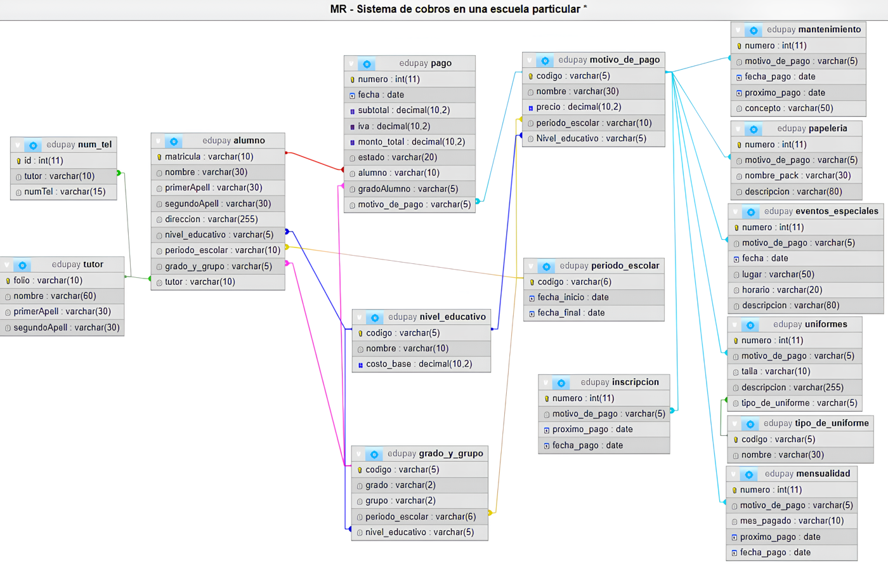

<div align="center">

# EDU-PAY

**Sistema de cobros para una escuela particular — preescolar, primaria y secundaria.**

  [](https://github.com/RobiiAragon/EDU-PAY/actions/workflows/ci.yml) 

[English](README.md) · **Español**

</div>

---

Aplicación de consola en Java y MySQL, hecha como proyecto de la materia de bases de datos (UTT · Equipo 7). Maneja inscripciones, colegiaturas y todos los cobros extra que tiene una escuela particular durante el año.

## Funciones

- 👩‍🎓 Alumnos y tutores: alta, edición y consulta.
- 💳 **Cobros anuales**: inscripción y mantenimiento.
- 🧾 **Cobros opcionales**: paquetes de papelería, uniformes y eventos especiales.
- 📅 **Mensualidades**, incluyendo los dos meses de vacaciones de verano (se cubren en diciembre y en marzo).
- 🧮 Subtotal, IVA y total de cada pago, ligado al periodo escolar y al grado.

## Base de datos

<p align="center"></p>

El diseño completo está en [`docs/`](docs): diagrama entidad-relación, modelo relacional, catálogo de datos y el documento final.

## Cómo correrlo

1. Crea la base de datos con los scripts de [`src/DB/`](src/DB) (`EDU-PAY.sql` y luego `InsertsPrueba.sql` para datos de prueba).
2. Descarga el `.jar` de [MySQL Connector/J](https://dev.mysql.com/downloads/connector/j/).
3. Compila y ejecuta:

```sh
javac -encoding UTF-8 -d out src/App.java src/Addons.java
java -cp "out:mysql-connector-j.jar" App        # en Windows usa ; en lugar de :
```

La conexión y la contraseña de administrador se pueden cambiar con variables de entorno:

| Variable | Por defecto |
| --- | --- |
| `EDUPAY_DB_URL` | `jdbc:mysql://localhost:3306/sistema_de_cobros_escolares` |
| `EDUPAY_DB_USER` / `EDUPAY_DB_PASS` | `root` / *(vacío)* |
| `EDUPAY_ADMIN_PASSWORD` | `admin` |

Hay una plantilla en [`.env.example`](.env.example). Pon una contraseña de administrador real antes de usarlo en serio: la app avisa al arrancar mientras siga la de por defecto. Todos los menús que modifican o eliminan registros piden la contraseña de administrador, y al escribirla en una terminal no se muestra.

> En el código las tablas van en MAYÚSCULAS y en el volcado en minúsculas. En Windows/macOS no pasa nada; en MySQL sobre Linux configura `lower_case_table_names=1`.

## Estructura

```
src/App.java      menú principal
src/Addons.java   operaciones con la base de datos (JDBC)
src/DB/           esquema, datos de prueba y consultas
src/DEMO/         demo independiente sin base de datos
docs/             diagramas, catálogo de datos y documento final
```

---

Hecho por **[Jesús Aragón](https://github.com/RobiiAragon)** · [Portafolio](https://robiiaragon.github.io/portfolio/)
