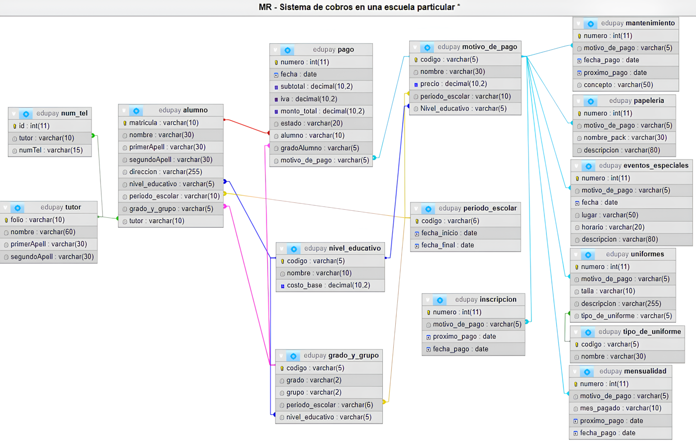

<div align="center">

# EDU-PAY

**Payment management system for a private school — preschool, elementary and middle school.**

  [](https://github.com/RobiiAragon/EDU-PAY/actions/workflows/ci.yml) 

**English** · [Español](README.es.md)

</div>

---

A console application built with Java and MySQL as a database course project (UTT · Team 7). It handles enrollment, tuition and every extra charge a private school deals with during the year.

## Features

- 👩‍🎓 Students and guardians: register, edit and look up.
- 💳 **Annual fees** — enrollment and maintenance.
- 🧾 **Optional fees** — stationery packs, uniforms and special events.
- 📅 **Monthly tuition**, including the two summer-vacation months (paid in December and March).
- 🧮 Subtotal, tax and total for every payment, linked to the school period and grade.

## Database

<p align="center"></p>

The full design is in [`docs/`](docs): ER diagram, relational model, data catalog and the final report.

## Run it

1. Create the database with the scripts in [`src/DB/`](src/DB) (`EDU-PAY.sql`, then `InsertsPrueba.sql` for sample data).
2. Download the [MySQL Connector/J](https://dev.mysql.com/downloads/connector/j/) `.jar`.
3. Compile and run:

```sh
javac -encoding UTF-8 -d out src/App.java src/Addons.java
java -cp "out:mysql-connector-j.jar" App        # on Windows use ; instead of :
```

The database connection and admin password can be changed with environment variables:

| Variable | Default |
| --- | --- |
| `EDUPAY_DB_URL` | `jdbc:mysql://localhost:3306/sistema_de_cobros_escolares` |
| `EDUPAY_DB_USER` / `EDUPAY_DB_PASS` | `root` / *(empty)* |
| `EDUPAY_ADMIN_PASSWORD` | `admin` |

There is a template in [`.env.example`](.env.example). Set a real admin password before using it anywhere: the app warns at startup while the default is in use. Every menu that changes or deletes records asks for the admin password, and the password is not echoed when you run it in a terminal.

> Table names in the code are UPPERCASE while the dump uses lowercase. That is fine on Windows/macOS; on Linux MySQL set `lower_case_table_names=1`.

> The app's menus are in Spanish, as it was built for a school in Mexico.

## Structure

```
src/App.java      main menu
src/Addons.java   database operations (JDBC)
src/DB/           schema, sample data and queries
src/DEMO/         standalone demo without a database
docs/             diagrams, data catalog and final report
```

---

Made by **[Jesús Aragón](https://github.com/RobiiAragon)** · [Portfolio](https://robiiaragon.github.io/portfolio/)
